# ShopPilot AI

Autonomous household grocery restocking agent that forecasts pantry depletion, optimizes multi-store baskets with delivery-fee-aware arithmetic, and executes policy-compliant checkout through PayPal Sandbox.

[Live demo](https://shoppilot-naa4.onrender.com/) · [Demo video](https://youtu.be/f6_ReQfaLtg) · [GitHub repository](https://github.com/div-gul/paypal)

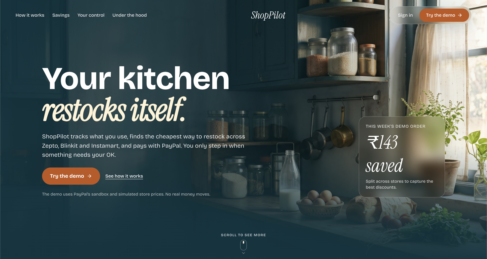

## What it does

Households repeatedly run out of staples at unpredictable hours, triggering rushed late-night orders and duplicate delivery fees across quick-commerce apps. ShopPilot AI turns reactive grocery ordering into a planned, autonomous process. The agent models consumption rates, predicts stockouts, and consolidates replenishments into scheduled weekly baskets. When restocking is required, it finds the cheapest fulfillment plan across multiple stores, prompts the user for substitutions or budget overruns, and completes payment through PayPal Sandbox.

1. **Tracks the pantry**: Predicts run-out dates based on household burn rates and depletion history.
2. **Plans a restock**: Groups depleted items into scheduled weekly cycles to avoid piecemeal delivery fees.
3. **Finds the cheapest basket**: Compares split-store and single-store consolidation to minimize combined item and delivery costs.
4. **Asks before big changes**: Requests user approval for brand substitutions or budget cap exceptions, then pays with PayPal.

## Project Demonstration & Visual Walkthrough

### 1. Autonomous Restock Planning & Basket Optimization
ShopPilot continuously forecasts household consumption rates. When inventory is projected to run out before the next scheduled delivery day, the agent bundles depleted items into a single, fee-optimized order. It dynamically compares fulfillment across **Zepto**, **Blinkit**, and **Instamart**, calculating tiered delivery, surge, and handling fees to determine whether store consolidation or split baskets save the most money.

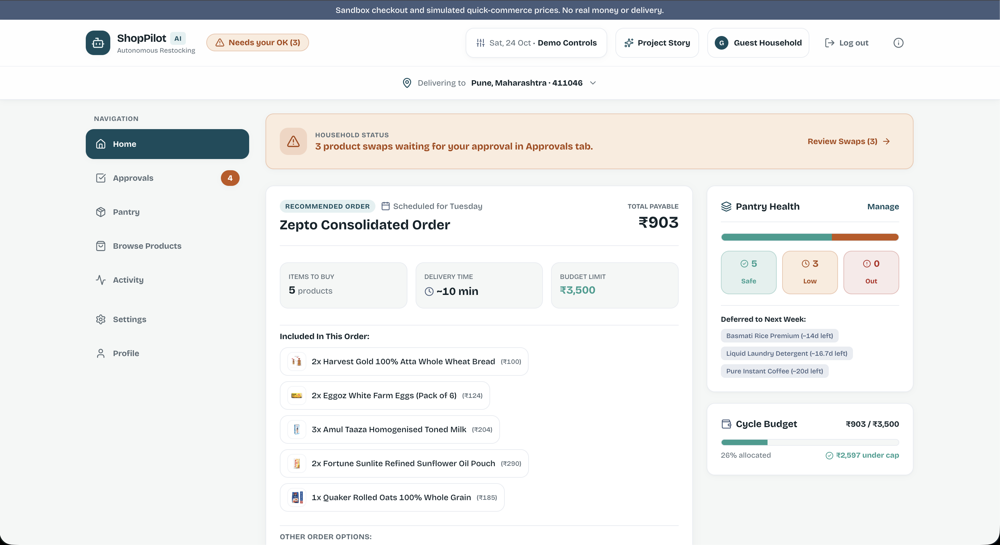

*The Home dashboard features a single hero order card with the recommended store strategy, delivery timing, fee breakdown, real-time budget progress bar, and "Running low" pantry countdowns.*

---

### 2. Human-in-the-Loop Brand Swap Approvals
ShopPilot operates with strict human oversight: it never swaps brands without user authorization. When a preferred brand is out of stock or an identical staple is available at significant savings, the agent presents an explainable swap suggestion with exact price deltas and plain-English reasoning.

| Swap Review & Rationale | Order Customization & Approval |
|:---:|:---:|
| 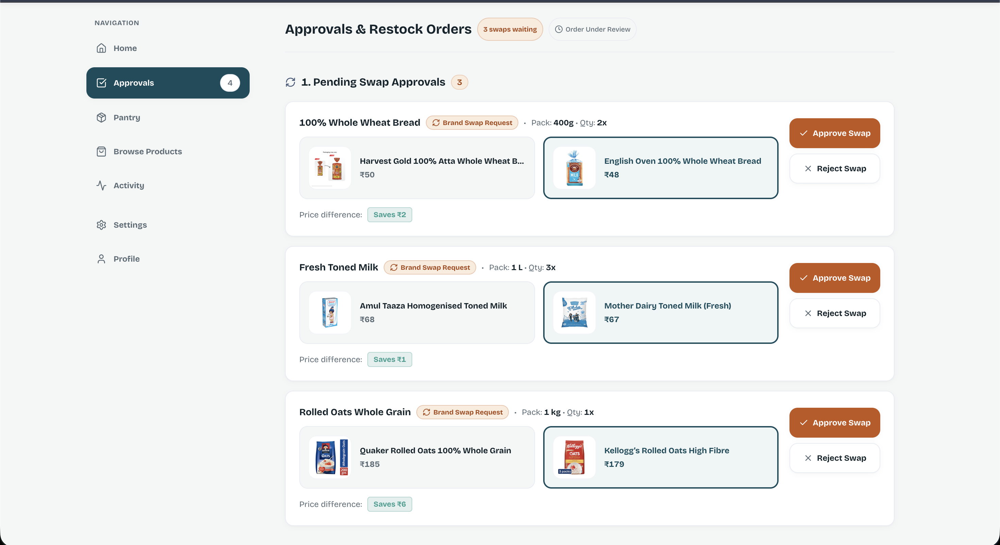 | 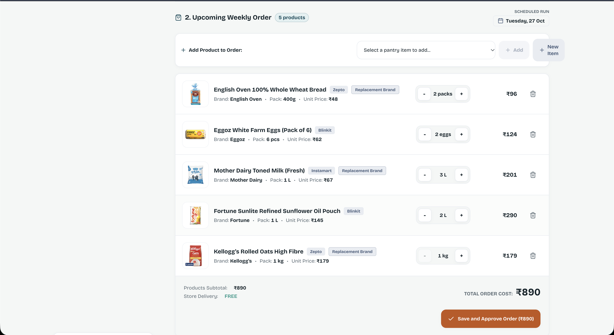 |

---

### 3. Secure PayPal Sandbox Checkout & Verification
Checkout is completely server-authoritative and idempotent. The backend computes order totals from verified catalog items, converts INR paise to USD at current conversion rates, locks the snapshot against customer delivery addresses, and mounts official PayPal JavaScript SDK buttons with instant QR codes for cross-device mobile testing.

| Store-Grouped Checkout Modal | PayPal Sandbox Approval Flow |
|:---:|:---:|
| 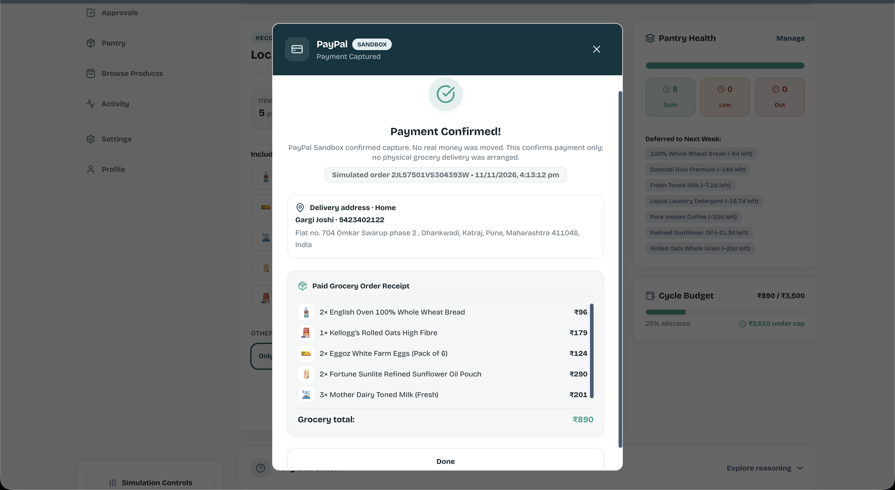 | 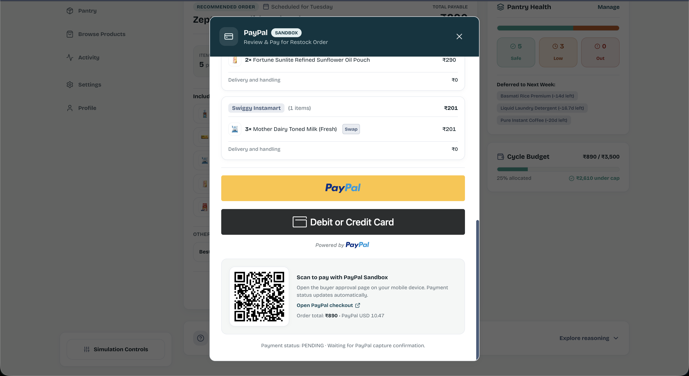 |

*Upon successful capture, ShopPilot atomically updates the local SQLite database, issues a settled order receipt, replenishes pantry stock, and logs an immutable audit event.*

---

### 4. Real-Time Household Pantry Inventory
The Pantry view provides a centralized inventory dashboard displaying current stock levels, daily burn rates, safety thresholds, and days remaining before stockout. Items can be rapidly adjusted using continuous stepper controls or edited with fine-grained consumption rules.

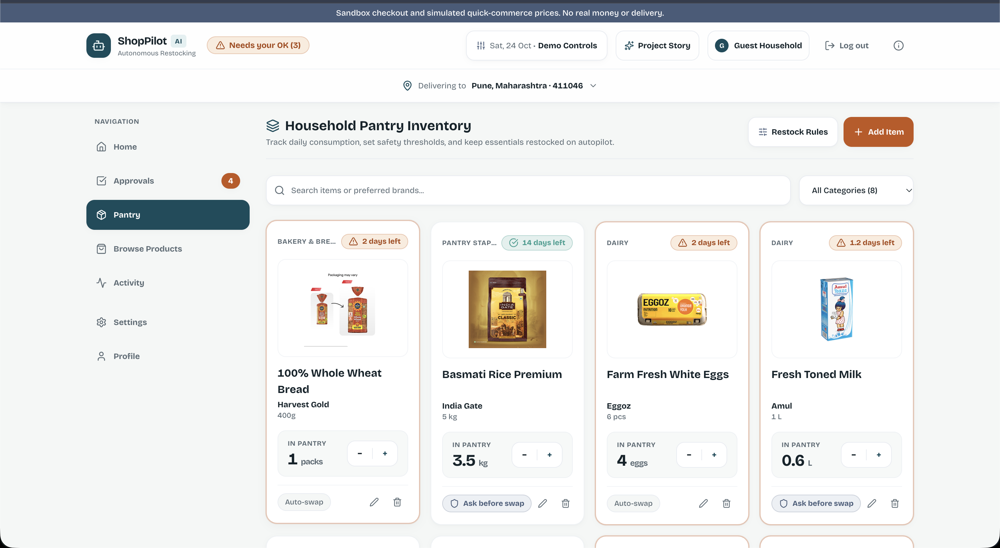

---

### 5. Multi-Store Grocery Catalog & Product Discovery
Users can explore 88 platform offers across 33 product categories in Katraj, Pune (PIN `411046`). The catalog provides real product photography, category filtering (*Dairy, Fresh Produce, Staples, Beverages, Snacks, Personal Care*), and multi-store price comparisons across Blinkit, Zepto, and Instamart with instant one-click pantry integration.

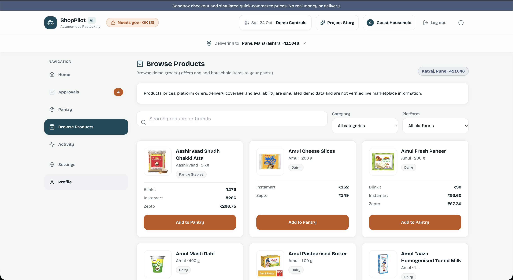

---

### 6. Autonomous Restock Activity & Audit Trail
Every autonomous evaluation, simulation clock advancement, policy modification, and payment confirmation is recorded in a transparent chronological timeline.

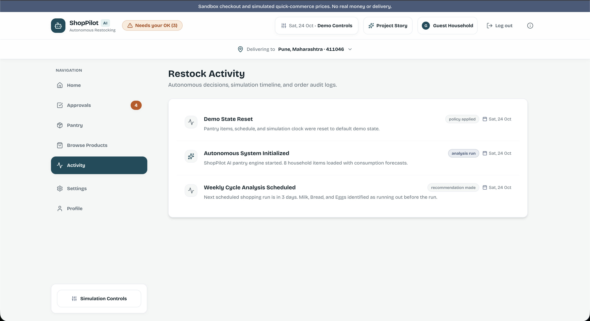

---

### 7. Household Policies & AI Rule Configuration
Users can customize restocking schedules, emergency buffer thresholds, and weekly spending caps using intuitive controls or natural language prompts powered by Google Gemini.

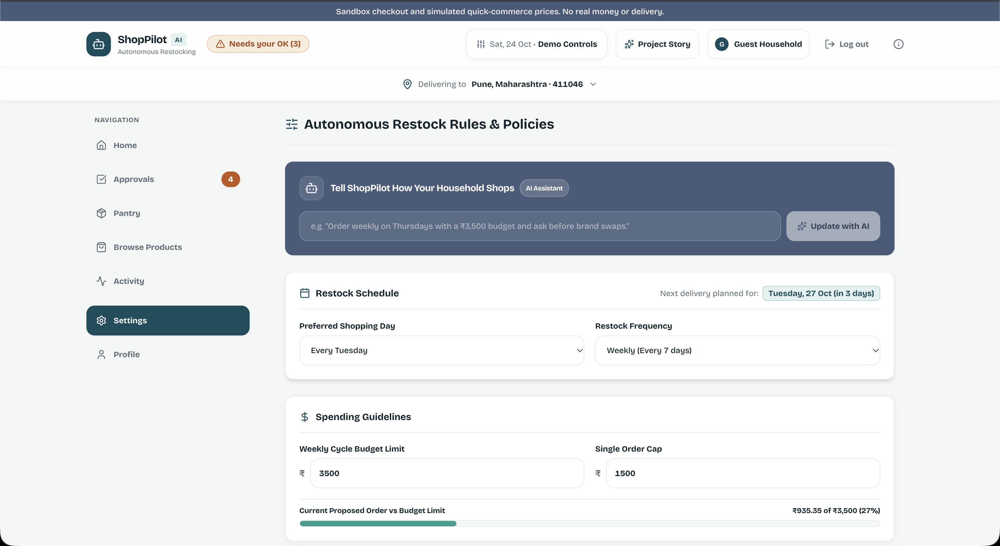

## For judges: try it in 3 minutes

Follow this path on the hosted demo to test the complete loop in three minutes:

1. **Open the demo**: Visit [the hosted demo](https://shoppilot-naa4.onrender.com/) to view the landing page overview.
2. **Use the guest demo**: Click **Instant Demo** to enter the pre-seeded demo household without registration.
3. **Advance time**: Open the **Time Machine** drawer in the header and click **+3 Days**; watch milk and daily staples deplete toward stockout.
4. **Review the restock order**: Check the **Upcoming Restock Order** card on the Home dashboard; notice depleted staples automatically queued with fee-optimized store routing and suggested quantities.
5. **Review brand swaps**: If a brand substitution is recommended (e.g. Quaker to Kellogg's oats), click **Review swaps** directly on the order card to view price deltas and AI reasoning, then approve or keep original.
6. **Inspect fulfillment strategy**: Click **Change order** on the Home card to compare consolidated vs split-store delivery strategies across Zepto, Blinkit, and Instamart.
7. **Pay with PayPal Sandbox**: Click **Approve & Pay**, review the store breakdown and delivery address snapshot, select the PayPal button, and complete payment in the sandbox modal.
8. **See the pantry restock**: After payment capture confirms, observe the confirmation receipt, replenished pantry stock gauges, and the new entry in the **Activity** audit log.
9. **Verify in PayPal**: Log into the Sandbox seller account listed above to verify the completed capture transaction under sandbox activity.

### PayPal Sandbox test accounts

Use these test accounts only with the PayPal Sandbox checkout flow:

| Role | Email | Password |
|---|---|---|
| Buyer | `buyer@shoppilot.com` | `buyer@123@1507` |
| Seller | `seller@shoppilot.com` | `seller123` |
| Alternate buyer | `buyer2@shoppilot.com` | `buyer2@123@1507` |

## How it uses PayPal

ShopPilot AI integrates the PayPal REST API (v2) and the PayPal JavaScript SDK using server-authoritative payment derivation:

- **OAuth 2.0 token grant** ([`backend/src/services/payment/PayPalSandboxProvider.ts`](backend/src/services/payment/PayPalSandboxProvider.ts#L61-L91)): Generates and caches bearer tokens using sandbox client credentials.
- **Orders v2 create** ([`backend/src/services/payment/PayPalSandboxProvider.ts`](backend/src/services/payment/PayPalSandboxProvider.ts#L131-L167)): Calls `POST /v2/checkout/orders` with a unique `PayPal-Request-Id` idempotency header derived from the run ID and revision timestamp.
- **JavaScript SDK & QR checkout** ([`frontend/src/components/CheckoutModal.tsx`](frontend/src/components/CheckoutModal.tsx#L35-L60)): Dynamically mounts official PayPal Buttons while providing an approval link and scannable QR code for mobile testing.
- **Orders v2 capture** ([`backend/src/services/payment/PayPalSandboxProvider.ts`](backend/src/services/payment/PayPalSandboxProvider.ts#L169-L180)): Calls `POST /v2/checkout/orders/{id}/capture` with an idempotency key upon buyer approval.
- **Webhook signature verification** ([`backend/src/services/payment/PayPalSandboxProvider.ts`](backend/src/services/payment/PayPalSandboxProvider.ts#L196-L218)): Validates PayPal transmission headers via `POST /v1/notifications/verify-webhook-signature`.

### Currency handling and inventory safety

PayPal Orders v2 does not support INR transactions. When configured with `PAYPAL_CURRENCY=USD`, the backend converts the integer paise total to USD cents using the configured rate (`PAYPAL_INR_PER_USD`). On capture, the server verifies that the captured USD amount converts back to within rounding tolerance of the approved INR order. Pantry stock replenishes only inside a SQLite database transaction after verified capture.

## How it uses AI

AI capabilities are powered by Google Gemini (`gemini-3.5-flash-lite`) via REST integration in [`backend/src/services/ai/LLMService.ts`](backend/src/services/ai/LLMService.ts):

- `POST /api/ai/parse-policy`: Parses natural language instructions (e.g. "Cap weekly grocery spending at 2000 rupees and shop on Tuesdays") into structured policy JSON proposals.
- `POST /api/ai/substitute`: Proposes best in-stock brand alternatives when preferred items are unavailable.

### Guardrails and constraints

- **Strict schema validation**: All model outputs are parsed through Zod schemas (`PolicyProposalSchema` and `SubstituteResultSchema`). Unparseable responses trigger immediate fallback.
- **Candidate allow-list**: The substitute endpoint evaluates only server-provided, in-stock catalog candidates. Hallucinated product IDs outside the list are rejected.
- **Human confirmation required**: AI outputs are strictly proposals. The AI cannot place orders, alter saved policies, or authorize payments autonomously.
- **Rate limits**: AI endpoints are rate-limited to 10 requests per minute and 100 requests per 24 hours per user.
- **Deterministic fallback**: If `LLM_API_KEY` is omitted or an external request fails, deterministic regex parsers and value heuristics execute locally.

## Real vs simulated

| Part | Status | Notes |
|---|---|---|
| PayPal checkout and capture | Real | Executed against PayPal Sandbox using official Orders v2 endpoints, SDK buttons, and webhook verification. |
| AI rule parsing and substitutions | Real | Calls Google Gemini (`gemini-3.5-flash-lite`) with Zod schema enforcement and catalog allow-lists. |
| Server-side policy checks | Real | Server enforces spending caps, category restrictions, and brand approval rules before order creation. |
| Store prices and delivery fees | Simulated | Derived from local seeded catalogs for Zepto, Blinkit, and Instamart with tiered fee rules. |
| Order delivery and fulfillment | Simulated | No live grocery dispatch occurs; orders conclude at payment capture and virtual stock replenishment. |
| Household clock and depletion | Simulated | Time Machine advances simulated dates to compute burn rates and stockout states on demand. |

No real money moves and no real grocery orders are placed.

### Seeded product catalog

The backend stores and serves a curated static demo catalog in SQLite for **Katraj, Pune, Maharashtra – 411046, India**: 33 product groups across 88 platform-specific offers from Blinkit, Zepto, and Instamart. Prices and offers are illustrative, not live-scraped or verified. Actual platform delivery coverage and inventory in this PIN code have not been confirmed.

The **Browse Products** view lets users search the catalog and filter by category or platform. Offers are grouped into unique product cards; adding one opens the pantry quantity dialog and saves it to that user's pantry. New accounts still start with an empty pantry. Prices do not represent verified current offers or stock.

### Delivery addresses and simulated orders

Users can save, edit, delete, and select multiple India delivery addresses, with one default address per account. Manual entry works without location access. **Use my current location** requests browser permission only after a click, then asks the backend to look up an approximate address through OpenStreetMap Nominatim; the returned fields remain editable, and raw coordinates are not stored. The public geocoder may be unavailable or imprecise, so manual entry remains available.

Checkout requires a selected saved address, which is attached to the existing simulated order and saved as an order-time snapshot. Later edits or deletion of the address do not change the historical order. PayPal Sandbox still handles the payment test; a successful payment does not place a grocery order or arrange physical delivery. Any valid Indian PIN code is accepted and does not affect access to the catalog, Shopping Agent, or checkout. Catalog prices remain illustrative Katraj, Pune – 411046 reference data; marketplace availability and delivery coverage are not verified.

## Architecture

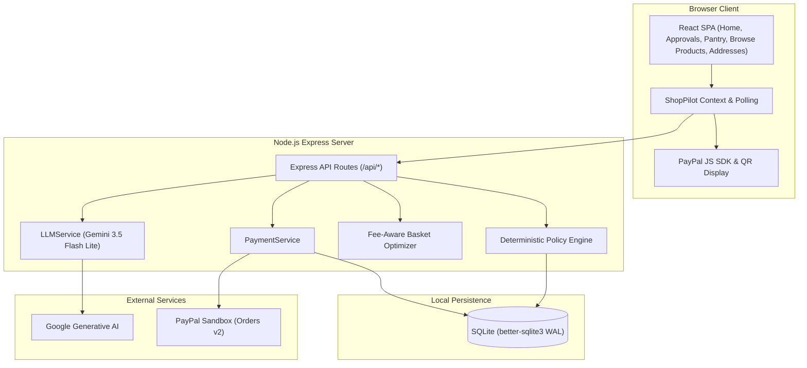

### Checkout sequence

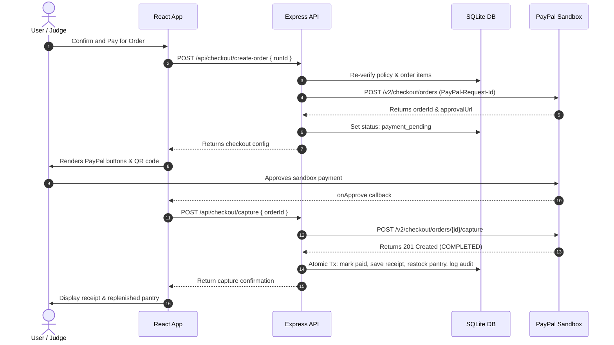

## Run it locally

### Prerequisites
- Node.js `v20.x` (verified on `v20.20.2`; required for native `better-sqlite3` bindings)
- npm `v10.x` or higher (verified on `10.8.2` and `11.12.1`)
- Git

### Installation and start

```bash
# 1. Clone repository
git clone https://github.com/div-gul/paypal.git
cd paypal

# 2. Install dependencies (root, backend, and frontend)
npm install
npm --prefix backend install
npm --prefix frontend install

# 3. Configure environment
cp .env.example .env
```

#### Minimum environment variables for mock mode (no keys required)
Works out of the box with zero external credentials:
```bash
PORT=3001
NODE_ENV=development
PAYPAL_MODE=mock
DATABASE_PATH=./data/shoppilot.db
APP_BASE_URL=http://localhost:5173
PUBLIC_APP_URL=http://localhost:5173
```

#### Minimum environment variables for PayPal Sandbox mode
To test real sandbox orders, update `.env` (credentials obtained from [developer.paypal.com](https://developer.paypal.com)):
```bash
PAYPAL_MODE=sandbox
PAYPAL_CLIENT_ID=your_sandbox_client_id
PAYPAL_CLIENT_SECRET=your_sandbox_client_secret
PAYPAL_CURRENCY=USD
PAYPAL_INR_PER_USD=85.00
LLM_API_KEY=your_gemini_api_key   # Optional: uses local NLP if omitted
```

```bash
# 4. Start frontend and backend concurrently
npm run dev
```

- **Frontend**: [http://localhost:5173](http://localhost:5173) (verified)
- **Backend API**: [http://localhost:3001](http://localhost:3001) (verified)
- **Health check**: [http://localhost:3001/api/health](http://localhost:3001/api/health) (verified)

### Resetting demo data
To reset the demo household to clean seed values, click **Reset Demo State** in the header or run:
```bash
curl -X POST http://localhost:3001/api/state/reset -H "Content-Type: application/json" --cookie "shoppilot_session=..."
```
Alternatively, delete `backend/data/shoppilot.db` and restart the backend.

## Environment variables

Configured in [`backend/src/config.ts`](backend/src/config.ts):

| Variable | Required | Default | Description |
|---|---|---|---|
| `PORT` | No | `3001` | Express backend listening port. |
| `NODE_ENV` | No | `development` | Environment mode (`development`, `test`, `production`). |
| `DATABASE_PATH` | No | `./data/shoppilot.db` | Filesystem path for SQLite database. |
| `PAYPAL_MODE` | No | `mock` | Payment mode: `mock`, `sandbox`, or `live`. |
| `ALLOW_LIVE_PAYMENTS` | No | `false` | Safety toggle; must be `true` with `PAYPAL_MODE=live` to charge real funds. |
| `PAYPAL_CLIENT_ID` | Sandbox only | `undefined` | PayPal REST application Client ID. |
| `PAYPAL_CLIENT_SECRET` | Sandbox only | `undefined` | PayPal REST application Client Secret (server-side only). |
| `PAYPAL_WEBHOOK_ID` | No | `undefined` | PayPal Webhook ID for signature verification. |
| `PAYPAL_BASE_URL` | No | `https://api-m.sandbox.paypal.com` | PayPal REST API origin. |
| `PAYPAL_CURRENCY` | No | `INR` | Charge currency (`INR` or `USD`). |
| `PAYPAL_INR_PER_USD` | USD mode | `undefined` | Required explicit conversion rate when charging in USD. |
| `APP_BASE_URL` | No | `http://localhost:5173` | Frontend application URL for returns and CORS. |
| `PUBLIC_APP_URL` | No | `APP_BASE_URL` origin | Browser origin permitted by CORS and CSRF guards. |
| `GOOGLE_CLIENT_ID` | No | `undefined` | Google OAuth Client ID for Google Identity Services. |
| `GOOGLE_CLIENT_SECRET` | No | `undefined` | Google OAuth Client Secret. |
| `LLM_API_KEY` | No | `undefined` | Google Gemini API key; falls back to deterministic NLP if unset. |
| `SMTP_HOST` | No | `undefined` | SMTP server host for transactional emails. |
| `SMTP_PORT` | No | `587` | SMTP server port. |
| `SMTP_SECURE` | No | `false` | Direct TLS toggle for SMTP. |
| `SMTP_USER` | No | `undefined` | SMTP username. |
| `SMTP_PASS` | No | `undefined` | SMTP password. |
| `EMAIL_FROM` | No | `ShopPilot AI <no-reply@shoppilot.local>` | Sender address for outgoing emails. |

## API reference

| Method | Path | Auth | Description |
|---|---|---|---|
| `GET` | `/api/health` | Public | Service status and active PayPal mode. |
| `POST` | `/api/auth/register` | Public | Register new account with validation. |
| `POST` | `/api/auth/login` | Public | Sign in and receive 7-day session cookie. |
| `POST` | `/api/auth/logout` | Session | Revoke session and clear cookie. |
| `GET` | `/api/auth/me` | Session | Retrieve current authenticated user. |
| `POST` | `/api/auth/google` | Public | Google Identity Services token sign-in. |
| `GET` | `/api/state` | Session | Complete state snapshot (pantry, clock, policy, runs). |
| `POST` | `/api/state/reset` | Session (Guest) | Reset demo data to seed defaults. |
| `GET` | `/api/pantry` | Session | List household pantry items. |
| `POST` | `/api/pantry` | Session | Add new pantry staple with burn rate. |
| `POST` | `/api/pantry/from-catalog/:productId` | Session | Add a catalog product to the current user's pantry using submitted quantity settings. |
| `GET` | `/api/addresses` | Session | List the current user's saved delivery addresses. |
| `POST` | `/api/addresses` | Session | Add an India delivery address; the first address becomes the default. |
| `PUT` | `/api/addresses/:id` | Session | Edit an address owned by the current user. |
| `DELETE` | `/api/addresses/:id` | Session | Delete an owned address; choose a remaining address as default if needed. |
| `POST` | `/api/addresses/:id/default` | Session | Select an owned address as the default for future checkout. |
| `POST` | `/api/addresses/reverse-geocode` | Session | Request an approximate address from OpenStreetMap Nominatim using coordinates supplied after explicit browser consent. |
| `PUT` | `/api/pantry/:id` | Session | Update stock quantity or consumption rate. |
| `DELETE` | `/api/pantry/:id` | Session | Remove staple from pantry. |
| `GET` | `/api/policy` | Session | Get restocking rules and spending caps. |
| `PUT` | `/api/policy` | Session | Update shopping schedule and spending caps. |
| `GET` | `/api/time` | Session (Guest) | Get current simulation clock state. |
| `POST` | `/api/time/advance` | Session (Guest) | Advance clock by 1, 3, or 7 days and compute burn. |
| `GET` | `/api/quotes` | Session | Get simulated multi-store pricing. |
| `GET` | `/api/products` | Session | Browse the seeded Katraj demo catalog; defaults to PIN code `411046` and supports `pinCode`, `q`, `category`, `platform`, and `available` filters. Only PIN code `411046` is supported. |
| `POST` | `/api/runs/plan` | Session | Plan restock run and evaluate policy. |
| `PUT` | `/api/runs/:id/strategy` | Session | Change strategy on an unapproved run. |
| `POST` | `/api/runs/:id/approve` | Session | Approve flagged restock run. |
| `POST` | `/api/runs/:id/reject` | Session | Reject restock run. |
| `GET` | `/api/audit-log` | Session | Fetch immutable audit log entries. |
| `GET` | `/api/checkout/config` | Session | Fetch client checkout configuration. |
| `POST` | `/api/checkout/create-order` | Session | Create idempotent PayPal sandbox order. |
| `POST` | `/api/checkout/capture` | Session | Capture payment and atomically restock pantry. |
| `GET` | `/api/checkout/status/:runId` | Session | Query checkout status for recovery and QR flows. |
| `POST` | `/api/checkout/cancel` | Session | Cancel pending checkout while preserving plan. |
| `POST` | `/api/webhooks/paypal` | Public (Signed) | Process PayPal webhook events idempotently. |
| `POST` | `/api/ai/parse-policy` | Session | Parse plain English into policy proposal. |
| `POST` | `/api/ai/substitute` | Session | Propose substitute item from catalog allow-list. |

## Testing

Automated test suites cover policy evaluation, state transitions, idempotent capture, user scoping, migrations, and rate limits:

```bash
# Run backend Vitest suite (85 tests across 13 test files)
npm --prefix backend test

# Run frontend autonomous SSR verification suite (5 stages, 10 workflow tests)
npm --prefix frontend test

# Run full monorepo build verification
npm run build
```

- **Backend suite**: 85 passing tests verifying user isolation, schema migrations, brute-force login throttling, AI schema validation, policy rules, and idempotent payment capture.
- **Frontend suite**: Autonomous verification covering integer paise arithmetic, depletion forecasts, brand swap decisions, bucket editing, and multi-store delivery fee optimization.

## Security

Security controls implemented in code:

- **Cookie sessions**: 7-day session tokens stored as SHA-256 hashes in SQLite; cookies use `HttpOnly`, `SameSite=Lax`, and `Secure` in production ([`backend/src/middleware/auth.ts`](backend/src/middleware/auth.ts)).
- **User isolation**: All queries partition records strictly by authenticated user ID ([`backend/src/repositories/`](backend/src/repositories/)).
- **Delivery address ownership**: Address routes scope every read and write to the authenticated session; order-time address snapshots are stored with the user-scoped run.
- **Atomic settlement**: Payment capture, settled receipt generation, pantry replenishment, and audit logging execute inside a single SQLite transaction ([`backend/src/services/payment/PaymentService.ts`](backend/src/services/payment/PaymentService.ts)).
- **Request throttling**: In-memory rate limits on auth routes, checkout creation (10/hr), AI endpoints (10/min), and unauthenticated traffic ([`backend/src/middleware/rateLimit.ts`](backend/src/middleware/rateLimit.ts)).
- **Origin verification**: State-changing requests validate `Origin` against `PUBLIC_APP_URL` / `APP_BASE_URL` ([`backend/src/app.ts`](backend/src/app.ts)).
- **Hardened headers**: Restrictive Content Security Policy, `X-Frame-Options: DENY`, `X-Content-Type-Options: nosniff`, and production HSTS ([`backend/src/app.ts`](backend/src/app.ts)).
- **Live payment lockout**: Live transactions require `PAYPAL_MODE=live`, `ALLOW_LIVE_PAYMENTS=true`, and the live PayPal host; otherwise blocked ([`backend/src/config.ts`](backend/src/config.ts)).

See [SECURITY.md](SECURITY.md) for vulnerability reporting and deployment controls.

## Project structure

```
paypal/
├── backend/                  # Express REST API
│   ├── src/adapters/         # Server catalog and quote providers
│   ├── src/db/               # SQLite connection, migrations, and seed data
│   ├── src/middleware/       # Auth, rate limiting, logging, error handling
│   ├── src/repositories/     # User-scoped data access repositories
│   ├── src/routes/           # Zod-validated route controllers
│   ├── src/services/         # Business logic (Payment, Policy, AI, Pantry, Run)
│   └── src/__tests__/        # Backend Vitest automated test suites
├── frontend/                 # React 19 single-page application
│   ├── src/api/              # HTTP client and error handlers
│   ├── src/components/       # UI views (Home, Approvals, Pantry, Browse Products, Delivery Addresses, CheckoutModal)
│   ├── src/context/          # Application state, saved address, and recovery polling
│   └── src/tests/            # Autonomous verification test suite
├── shared/                   # Pure business logic shared across client and server
│   ├── adapters/             # Quick-commerce store adapters (Blinkit, Zepto, Instamart)
│   ├── services/             # Optimizer, consumption engine, scheduler, currency math
│   └── types/                # Canonical domain models and TypeScript interfaces
└── docs/                     # Architectural specs, Devpost submission, screenshot guides
```

## Limitations and what's next

- **In-memory rate limiting**: Limiters store counters in single-process memory. Horizontal scaling requires an external store such as Redis.
- **Local SQLite persistence**: SQLite runs on the local filesystem. Production on Render requires an attached persistent disk mount (`/var/data`).
- **Simulated store integrations**: Quick-commerce stores are modeled through local seed catalogs rather than live private APIs.
- **Sandbox environment**: PayPal transactions run in Sandbox mode; no real financial settlement occurs.

### Roadmap
- Real quick-commerce store partnerships and catalog sync.
- Pre-authorized recurring household restocking with saved payment methods via PayPal Vault.
- Receipt OCR and barcode scanning for instant pantry logging.
- Multi-household accounts with granular per-member spending limits and shared approvals.

## Credits and notices

- **License**: Released under the [MIT License](LICENSE). Copyright (c) 2026 Divyani Gulhane and Gargi Joshi.
- **Typography**: [Bricolage Grotesque](https://github.com/alphanew/bricolage) (Open Font License), [Instrument Serif](https://github.com/Instrument/instrument-serif) (Open Font License).
- **Icons**: [Lucide React](https://lucide.dev) (ISC License).
- **AI-generated landing imagery**: Marketing graphics on the landing page were generated using AI design tools to illustrate household pantry concepts.
- **Notice**: Zepto, Blinkit, Instamart, and product brand names are used solely to illustrate simulated quick-commerce data. This project is not affiliated with, sponsored by, or endorsed by them or by PayPal.

Built for the **Build What's Next with PayPal and AI** hackathon.
