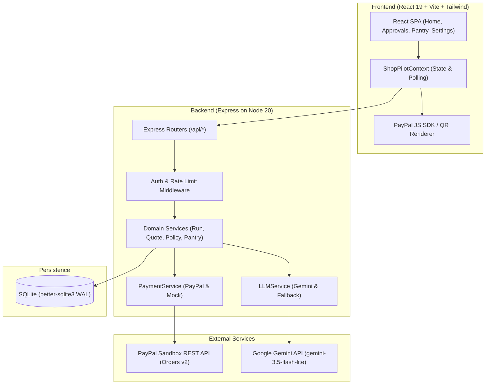
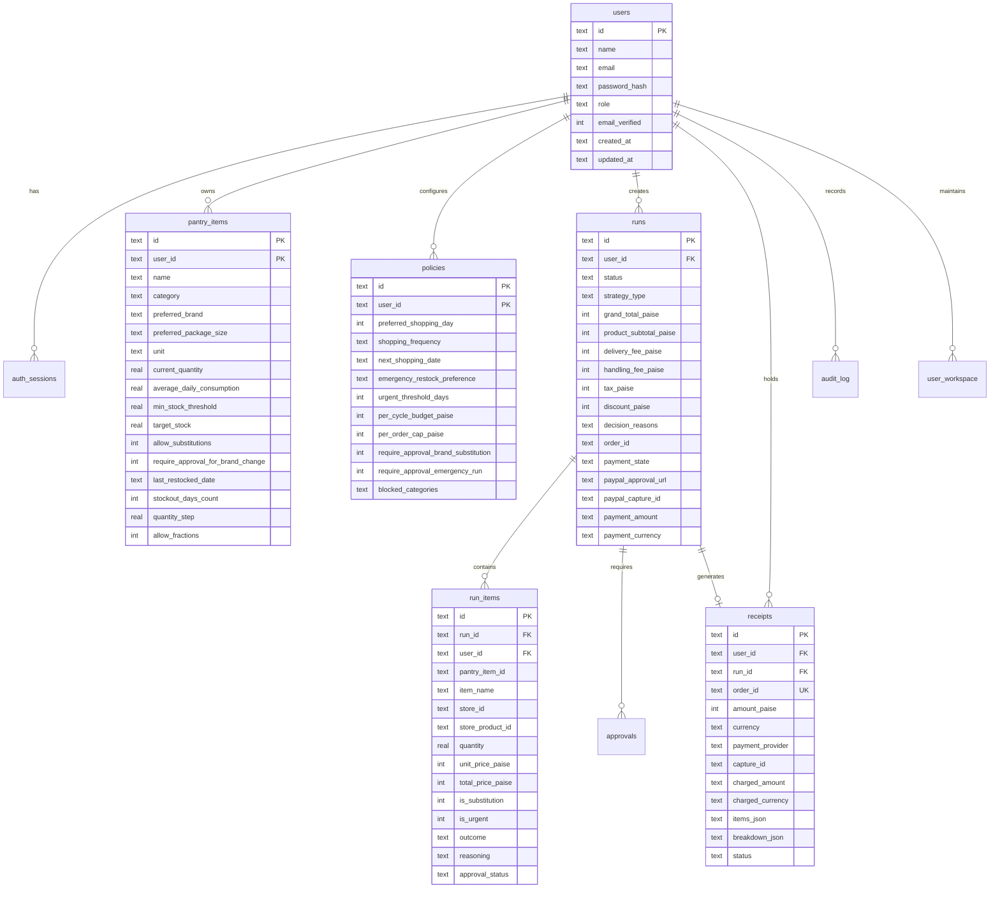
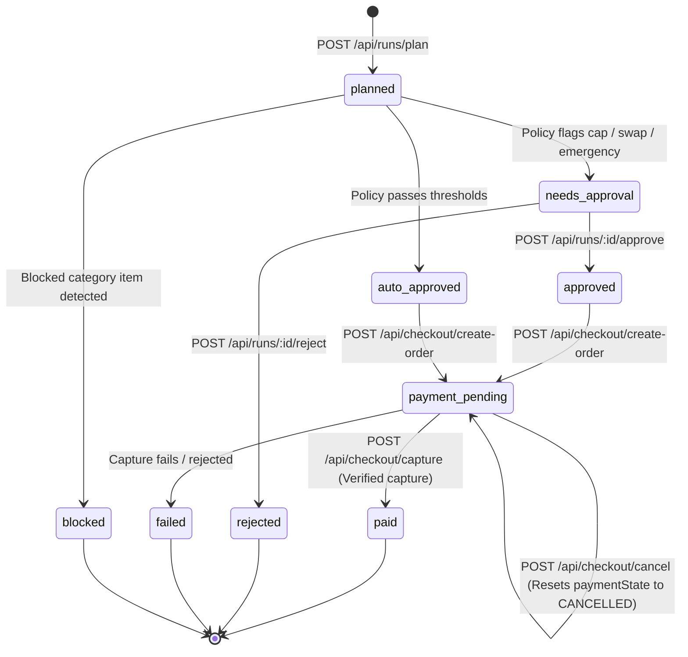
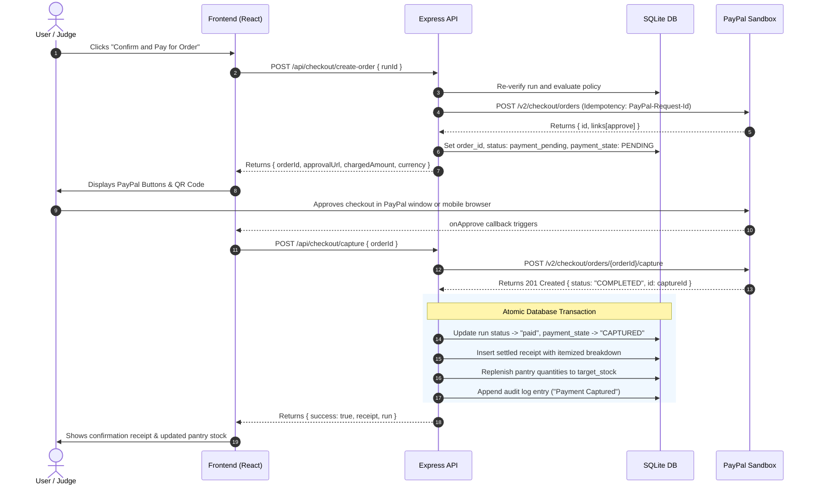

# Architecture and technical design

ShopPilot AI is an autonomous grocery replenishment engine designed for household pantry management and multi-store basket optimization with PayPal Sandbox payment settlement.

---

## System architecture

The application is structured as a TypeScript monorepo with three layers:

---

## Data model

The database layer runs on SQLite via `better-sqlite3` with foreign keys and WAL mode enabled (`backend/src/db/migrate.ts`). All domain tables are partitioned by `user_id`.

Additional tables:
- `auth_sessions`: Active cookie session hashes (`token_hash`, `user_id`, `expires_at`).
- `password_resets`: Password reset tokens (`token_hash`, `user_id`, `expires_at`, `used_at`).
- `email_verifications`: Email verification tokens (`token_hash`, `user_id`, `expires_at`, `used_at`).
- `sim_clock`: Per-user simulation date, cycle count, and days elapsed.
- `user_workspace`: Draft upcoming order JSON and approved/rejected brand swap choices.
- `audit_log`: Immutable timeline entries (`timestamp`, `simulated_date`, `type`, `title`, `description`, `status_badge`, `badge_color`).
- `webhook_events`: Idempotency tracking for PayPal webhook delivery (`id`, `event_type`, `resource_id`, `processed`, `processed_at`).

---

## Run state machine

A restock run lifecycle progresses through deterministic states managed by `RunRepository` and `PaymentService`:

### Associated payment states

Each run tracks `payment_state` alongside its status:
- `PENDING`: PayPal order created; awaiting buyer approval.
- `APPROVED`: Buyer approved checkout on PayPal; awaiting capture.
- `CAPTURED`: Capture successfully processed and confirmed.
- `CANCELLED`: Buyer exited or clicked cancel; order retained for retry.
- `FAILED`: Payment provider rejected the capture request.

---

## Money rules and currency conversion

All internal accounting and price comparisons operate strictly on integer paise (`shared/services/currency.ts`):
- `1 INR = 100 paise` (e.g. ₹1,499.50 is stored and calculated as `149950`).
- Integer math prevents floating-point accumulator drift across item prices, taxes, and fees.

### PayPal currency handling

Because the PayPal Orders API does not support INR as a payment currency, cross-border or foreign sandbox testing requires converting INR amounts to USD:
1. `PAYPAL_CURRENCY=USD` and an explicit `PAYPAL_INR_PER_USD` exchange rate (e.g. `85.00`) are defined in configuration.
2. The USD charge is computed using integer cents rounding:
   $$\text{usdCents} = \text{round}\left(\frac{\text{amountPaise}}{\text{inrPerUsd}}\right)$$
   $$\text{chargeAmount} = \frac{\text{usdCents}}{100}$$
3. During capture, the backend checks that the captured USD amount converts back to within half a cent equivalent of the original INR total:
   $$\left|\text{round}(\text{capturedUsdCents} \times \text{inrPerUsd}) - \text{grandTotalPaise}\right| \le \left\lceil\frac{\text{inrPerUsd}}{2}\right\rceil$$
4. No automatic or third-party FX conversions occur; the rate must be explicitly configured.

---

## Checkout and webhook flows

The checkout sequence coordinates the browser, Express backend, PayPal REST API, and SQLite database:

### Webhook verification

When configured (`PAYPAL_WEBHOOK_ID`), incoming webhook events are processed at `POST /api/webhooks/paypal`:
1. The server extracts PayPal signature headers: `paypal-auth-algo`, `paypal-cert-url`, `paypal-transmission-id`, `paypal-transmission-sig`, and `paypal-transmission-time`.
2. The server verifies the signature by calling `POST /v1/notifications/verify-webhook-signature` on the PayPal Sandbox API.
3. If verified, the event ID is checked in `webhook_events` to ensure idempotency. Duplicate events return HTTP 200 immediately without reprocessing.
4. If an order was approved outside the active browser tab, the webhook invokes `syncOrderFromWebhook` to complete the transaction.

---

## Policy engine rules

The policy engine (`shared/policy.ts`) enforces household governance rules deterministically on every restock plan and rechecks them at checkout:

| Rule | Trigger Condition | Decision | Explanation |
|---|---|---|---|
| **Blocked categories** | Any basket item category appears in `policy.blockedCategories` | `blocked` | Hard block. Order cannot be created or checked out until prohibited items are removed. |
| **Per-order spending cap** | `strategy.grandTotalPaise > policy.perOrderCapPaise` | `needs_approval` | Requires manual user confirmation before order is payable. |
| **Weekly / cycle budget cap** | `strategy.grandTotalPaise > policy.perCycleBudgetPaise` | `needs_approval` | Prevents automated spending exceeding the household cycle budget. |
| **Brand substitution** | Item is substitution and `policy.requireApprovalBrandSubstitution` is true | `needs_approval` | User must approve the brand replacement before checkout. |
| **Off-cycle emergency run** | Off-cycle restock and `policy.requireApprovalEmergencyRun` is true | `needs_approval` | Flags standalone delivery fee incurrence for off-cycle orders. |
| **Compliant basket** | All thresholds and constraints met | `auto_approved` | Order is pre-authorized and immediately payable. |

---

## Design decisions

1. **AI proposes and code decides**:
   - The LLM parses plain English into structured JSON proposals and recommends item substitutes from server-supplied candidates.
   - Code enforces the boundaries: Zod schemas validate every AI output, candidate allow-lists reject hallucinated product IDs, and the policy engine strictly controls approvals. The AI cannot place orders or mutate records autonomously.
2. **Server is the source of truth**:
   - The browser never dictates prices, totals, or item lists at checkout.
   - The checkout endpoint recalculates and validates the entire restock basket against the stored run, current pantry state, and policy limits before contacting PayPal.
3. **Restock only after verified capture**:
   - Pantry inventory is never updated upon order creation or payment authorization.
   - Stock replenishment occurs exclusively inside the atomic database transaction that records the settled receipt after PayPal returns a confirmed `COMPLETED` capture.

